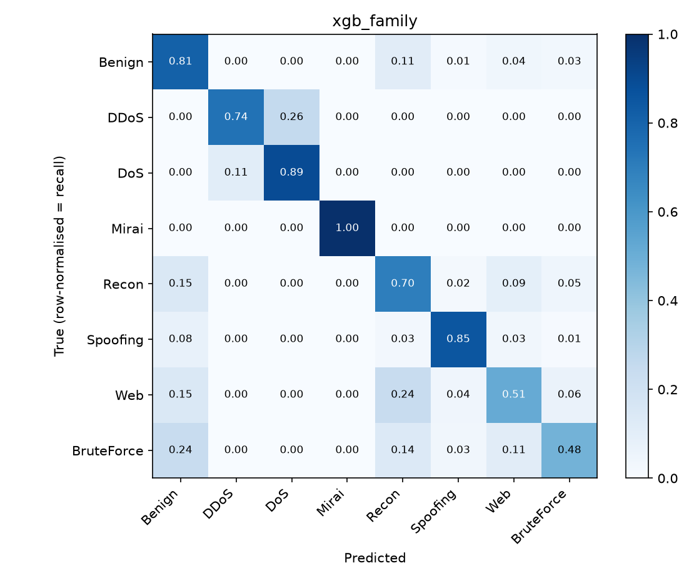
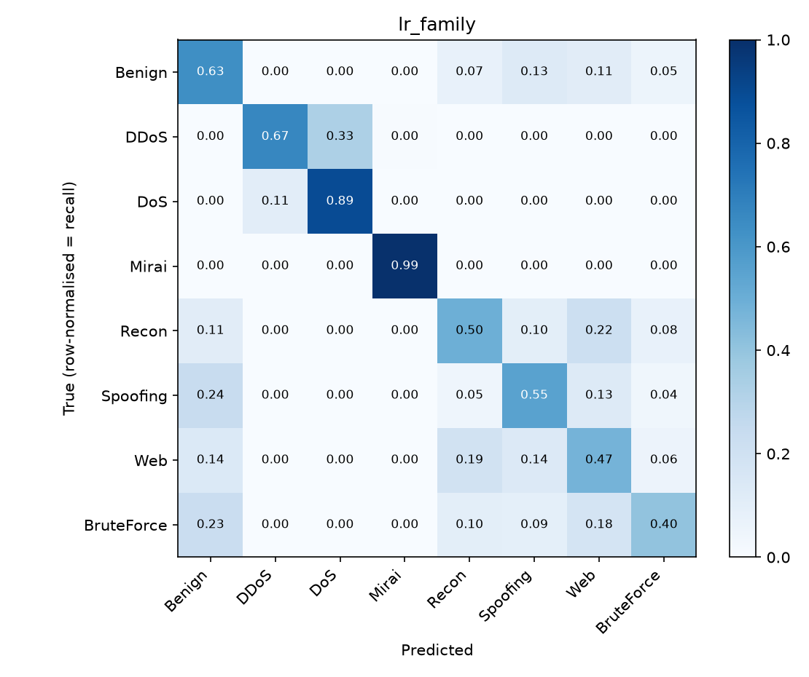
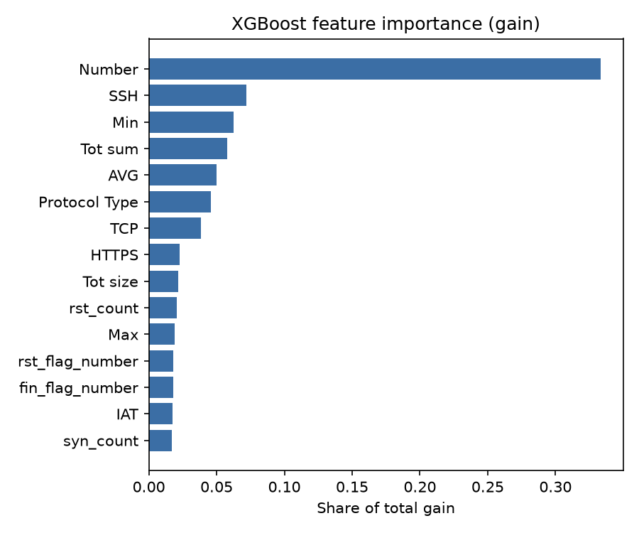

# Network Intrusion Detection on IoT Traffic: Milestone Report

CPS 536 Machine Learning, Fall 2026 · Oct 30, 2026 · Ahmed Soliman

Code: <https://github.com/Ahmed-Soliman1/iot-intrusion-detection>

## 1. Motivation and Introduction

Internet-of-Things (IoT) devices such as cameras, smart plugs and sensors are cheap, numerous and rarely patched. That makes them easy to hijack, and botnets such as Mirai have turned large numbers of them into sources of distributed denial-of-service (DDoS) traffic. A network intrusion detection system (NIDS) watches traffic and flags malicious flows. Machine-learning NIDSs learn this decision from labelled traffic features rather than hand-written signatures.

This project builds supervised classifiers that detect attacks in IoT traffic from flow-level features. There are two tasks:

1. **Binary:** benign vs. attack.
2. **8-class:** benign plus seven attack families (DDoS, DoS, Mirai, Recon, Spoofing, Web-based, Brute Force).

The data is very imbalanced: flood attacks produce millions of records, while web attacks and brute force produce only a few thousand. A model can therefore reach high accuracy while missing the rare attacks completely. For that reason we rank models by **macro-F1** and **per-class recall**, not accuracy. The final project will also test whether a model can detect an attack family it never saw during training.

For this milestone we have (i) downloaded, cleaned and de-duplicated a 5.7-million-row portion of CICIoT2023, (ii) trained and tuned two methods, **Logistic Regression** (taught in class) and **XGBoost** (not taught in class), and (iii) evaluated both on a held-out test set for both tasks.

## 2. Related Work

**CICIoT2023.** Neto et al. [1] released CICIoT2023: traffic from 105 IoT devices under 33 attacks in seven families, about 46.7 million records. Their baselines included Logistic Regression and Random Forest. Random Forest reached about 99% accuracy on the 34-class task, while Logistic Regression reached about 80%, which suggests that a linear model struggles to separate the attack types.

**Gradient boosting on CICIoT2023.** Almahaqeri et al. [2] compared XGBoost against Logistic Regression and other baselines on the same data. XGBoost reached about 99.6% binary accuracy and 0.89 macro-F1 on 8 classes, with the rare attack families scoring lowest. Their evaluation uses one dataset and does not test unseen attack types.

**Generalisation.** Guerra-Manzanares and Huang [3] trained detectors on one IoT dataset and tested them on others. In-dataset scores were high, but cross-dataset accuracy dropped to about 0.5 for most combinations. This is the main motivation for our planned leave-one-family-out experiment.

**Earlier IoT datasets.** N-BaIoT [7] captured Mirai and BASHLITE traffic from nine commercial IoT devices and detected it with per-device deep autoencoders. Bot-IoT [8] simulated a larger IoT network with DDoS, DoS, reconnaissance and data-theft traffic. CICIoT2023 is larger and more diverse than both, with more devices and more attack types.

**Pitfalls in security ML.** Arp et al. [9] list common mistakes in machine learning for security, including data snooping, spurious correlations and unrealistic class balance, all of which inflate reported scores. Engelen et al. [10] found labelling and feature-extraction errors in the widely used CICIDS2017 dataset, from the same lab and tooling family as CICIoT2023. Our cleaning findings (Section 3.2) show related problems in CICIoT2023. They also suggest that near-perfect scores reported on this data partly reflect duplicated records shared between the training and test sets.

**Methods.** XGBoost [4] is a gradient-boosted decision-tree ensemble with second-order optimisation and regularisation. SMOTE [5] oversamples rare classes with synthetic examples; we plan to test it in the next phase.

## 3. Data and Cleaning

### 3.1 Data used

CICIoT2023 is distributed as 63 "merged" CSV files, each a random mix of all classes. Each record summarises a window of packets and has 39 numeric features (header length, protocol flags and counts, packet-size statistics, inter-arrival time, rate, and others) plus one of 34 fine-grained labels. For this milestone we used the first **8 of the 63 files: 5,712,270 rows** (about 12% of the dataset). The class proportions match the full set, and every attack type appears.

### 3.2 Cleaning pipeline (`src/prepare_data.py`)

| Step | Rows removed | Rows left |
|---|---:|---:|
| Raw (8 files) | | 5,712,270 |
| Rows with NaN / ±inf values | 125 | 5,712,145 |
| Exact duplicates within a file | 1,346,349 | 4,365,796 |
| Exact duplicates across files | 1,053,648 | 3,312,148 |
| Same feature vector with conflicting labels | 274,697 | **3,037,451** |
| Cap at 100,000 rows per fine-grained label | 1,363,485 | **1,673,966** |

Notes on each step:

- **Duplicates: 42% of the raw rows** are exact copies of another row. If they are not removed before splitting, identical rows end up in both the training and test sets, and the test score partly measures memorisation.
- **Conflicting labels:** 274,697 rows share an identical feature vector with a row of a different label. Almost all of them are DoS and DDoS versions of the same flood: for example, 39,562 rows labelled `DOS-TCP_FLOOD` are identical to 39,562 rows labelled `DDOS-TCP_FLOOD`, and the UDP and SYN floods behave the same way. Because these windows cannot be told apart from the features, we dropped them. This gives an upper bound on how well any model can separate DoS from DDoS.
- **Per-label cap:** the largest classes have hundreds of thousands of rows. We randomly kept at most 100,000 rows per fine-grained label and kept every rare class whole. This produces the 1–2 million-row sample planned in the proposal while losing no minority-class data.
- **Labels:** the 34 labels were mapped to 8 families as in [1], plus a binary benign/attack label.
- **Split:** stratified on the fine-grained label into 70% train (1,171,776), 15% validation (251,095) and 15% test (251,095).

Family sizes after sampling (all three splits combined):

| Family | Rows | Share |
|---|---:|---:|
| DDoS | 831,014 | 49.6% |
| DoS | 308,709 | 18.4% |
| Mirai | 290,582 | 17.4% |
| Benign | 100,000 | 6.0% |
| Recon | 82,925 | 5.0% |
| Spoofing | 56,121 | 3.4% |
| Web | 3,003 | 0.18% |
| Brute Force | 1,612 | 0.10% |

The largest family is about 500 times bigger than the smallest, so imbalance remains severe even after the cap.

## 4. Methods

### 4.1 Logistic Regression (taught in class)

Logistic Regression is a linear model. For the binary task it predicts *P(attack | x) = σ(wᵀx + b)*, and for 8 classes it uses the softmax (multinomial) version. It is trained by minimising cross-entropy with an L2 penalty whose strength is set by *C*.

Many features are heavy-tailed (for example `Rate`, `IAT` and `Variance` span several orders of magnitude). We therefore apply a signed log transform, sign(x)·log(1+|x|), followed by standardisation, both fitted on training data only. The solver is L-BFGS with up to 2,000 iterations. We tune *C* ∈ {0.01, 0.1, 1, 10} on the validation set by macro-F1.

### 4.2 XGBoost (not taught in class)

XGBoost [4] builds an additive ensemble of regression trees, *F(x) = Σₖ fₖ(x)*. Each new tree is fitted to the gradient and Hessian of the loss with respect to the current ensemble's predictions, so it corrects the errors of the trees before it. Splits are chosen to maximise a gain that includes L2 regularisation on leaf weights and a penalty for each extra leaf, which limits overfitting. Trees need no feature scaling and can represent non-linear interactions, such as "few packets *and* the HTTPS flag set", that a linear model cannot.

Settings: histogram split finding, learning rate 0.1, row subsampling 0.8, column subsampling 0.8. The number of trees (up to 1,500) is chosen by early stopping on validation log-loss with a patience of 30 rounds. We tune `max_depth` ∈ {6, 10} on validation macro-F1. A full explanation of the algorithm will be included in the final report.

### 4.3 Handling class imbalance

By default both models use **balanced class weights**: each training example is weighted in inverse proportion to its class frequency, so every class contributes equally to the loss. As a first comparison we also trained both models without weights. Undersampling and SMOTE are planned next.

### 4.4 Evaluation

Hyper-parameters are chosen on the validation set only, and every number below comes from the untouched test set. We report accuracy, balanced accuracy (mean per-class recall), macro-F1, weighted-F1, ROC-AUC (one-vs-rest macro average for 8 classes), per-class precision and recall, and confusion matrices. All randomness uses seed 42.

## 5. Preliminary Results

### 5.1 Overall test-set results

| Task | Model | Best hyper-parameter | Accuracy | Balanced acc. | **Macro-F1** | ROC-AUC |
|---|---|---|---:|---:|---:|---:|
| Binary | Logistic Regression | C = 10 | 0.931 | 0.962 | 0.797 | 0.984 |
| Binary | XGBoost | depth 6, 354 trees | **0.962** | **0.974** | **0.867** | **0.994** |
| 8-class | Logistic Regression | C = 1 | 0.751 | 0.639 | 0.553 | 0.969 |
| 8-class | XGBoost | depth 10, 72 trees | **0.819** | **0.748** | **0.664** | **0.982** |
| 8-class | Logistic Regression, no class weights | C = 10 | 0.812 | 0.567 | 0.585 | 0.969 |
| 8-class | XGBoost, no class weights | depth 6, 1,021 trees | 0.867 | 0.685 | 0.716 | 0.984 |
| 8-class | XGBoost, `IAT` removed | depth 10, 81 trees | 0.820 | 0.748 | 0.666 | 0.982 |

With the same settings, XGBoost beats Logistic Regression on every metric in both tasks: +7 macro-F1 points for the binary task and +11 for the 8-class task. The gap is consistent with [1] and [2].

**Binary task.** Both models catch almost all benign traffic (benign recall 0.996 for LR and 0.989 for XGBoost). Because of the balanced weights, the models err toward calling traffic benign, so benign precision is low (0.46 for LR, 0.61 for XGBoost). Attack recall is 0.927 for LR and 0.960 for XGBoost. In a deployed NIDS one would move the decision threshold to trade false alarms against missed attacks. A high ROC-AUC (0.994) with a moderate F1 means the ranking is good but the default 0.5 threshold is not.

### 5.2 Per-class results (8-class task, test set)

Recall / F1:

| Class | Test rows | Logistic Regression | XGBoost | LR, no weights |
|---|---:|---|---|---|
| Benign | 15,000 | 0.635 / 0.680 | **0.809 / 0.816** | 0.799 / 0.730 |
| DDoS | 124,652 | 0.667 / 0.782 | 0.742 / 0.833 | **0.911 / 0.865** |
| DoS | 46,307 | **0.893** / 0.643 | **0.893 / 0.691** | 0.476 / 0.556 |
| Mirai | 43,588 | 0.993 / 0.989 | **0.998 / 0.998** | 0.991 / 0.992 |
| Recon | 12,437 | 0.495 / 0.609 | 0.699 / **0.751** | **0.731** / 0.723 |
| Spoofing | 8,418 | 0.553 / 0.568 | **0.852 / 0.894** | 0.479 / 0.558 |
| Web | 451 | 0.475 / 0.070 | **0.512 / 0.171** | 0.000 / 0.000 |
| Brute Force | 242 | 0.405 / 0.082 | **0.479** / 0.158 | 0.149 / **0.254** |

*Figure 1. Row-normalised confusion matrix of XGBoost on the 8-class test set (each diagonal cell is that class's recall).*

*Figure 2. The same for Logistic Regression.*

### 5.3 Observations

1. **Mirai is easy for both models** (F1 0.99 to 1.00). Its GRE and UDP-plain floods have distinctive protocol signatures.
2. **DoS vs. DDoS is the largest source of error.** XGBoost labels 26% of DDoS test rows as DoS (32,036 rows), and LR labels 33% (40,827 rows). These are the same flood types that produced identical feature vectors with conflicting labels during cleaning (Section 3.2). The per-window features describe the packets, not how many sources sent them, so this error probably cannot be removed with these features alone. Grouping DoS and DDoS together, or adding source-diversity features, are options for the final report.
3. **Benign, Recon, Spoofing, Web and Brute Force are confused with one another, not with the floods.** All of these are low-rate traffic. XGBoost separates them much better than LR (for example Spoofing F1 0.89 vs. 0.57 and Recon 0.75 vs. 0.61), which suggests the boundaries are non-linear.
4. **The rare classes are the main problem.** Web (451 test rows) and Brute Force (242) reach about 0.5 recall, but their F1 is only 0.16–0.17. The class weights make the models predict them often, so most of those predictions are false alarms on Benign or Recon rows: precision is about 0.1.
5. **Class weights trade majority-class accuracy for minority-class recall.** Without weights, LR gains accuracy (0.81 vs. 0.75) and macro-F1 (0.585 vs. 0.553), almost entirely by predicting DDoS more often. However, it **never detects a single Web attack** (recall 0.000) and its Brute Force recall drops from 0.41 to 0.15. Accuracy and macro-F1 alone would hide this, which is why we also report per-class recall. XGBoost shows the same trade-off. Without weights it has the highest macro-F1 of all runs (0.716 vs. 0.664) and higher DDoS recall (0.91 vs. 0.74). However, its recall falls from 0.51 to 0.16 on Web and from 0.48 to 0.23 on Brute Force. Which setting is "better" depends on whether missing rare attacks or raising false alarms costs more. We will explore this further with undersampling and SMOTE.
7. **Removing `IAT` changes almost nothing** (macro-F1 0.666 vs. 0.664, with per-class recall within about 0.02). The model does not depend on this inter-arrival-time feature.
8. **Our scores are lower than published ones** (e.g. 0.89 8-class macro-F1 in [2]). Likely reasons are that we remove the 42% duplicate rows before splitting, drop rows with conflicting labels, and use only 12% of the data. We will test the first reason directly by re-running without de-duplication.

### 5.4 Feature importance (XGBoost)

*Figure 3. Top features of the 8-class XGBoost model by share of total split gain.*

In the 8-class model, `Number` (packets in the aggregation window) accounts for 33% of the total gain, followed by `SSH` (7%), `Min` (6%), `Tot sum` (6%), `AVG` (5%) and `Protocol Type` (5%). In the binary model, `Number` alone accounts for 86%. A single feature this dominant is a warning sign of the "spurious correlation" pitfall described in [9]: the window size may reflect how the dataset was generated rather than how attacks behave. Dropping `IAT` made no difference (Section 5.3), so the next ablation will drop `Number`.

## 6. Next Steps (to Nov 14)

- Imbalance: compare class weights with random undersampling and with SMOTE [5] applied to the training set only.
- Threshold tuning for the binary detector.
- Leave-one-attack-family-out: train without one family and measure how much of it is still flagged as an attack.
- Re-run without de-duplication to measure how much duplicates inflate scores.
- Feature ablation of `Number`, and a reduced feature set.
- Scale up from 8 to more of the 63 files if time and memory allow.

## References

1. E. C. P. Neto et al., "CICIoT2023: A Real-Time Dataset and Benchmark for Large-Scale Attacks in IoT Environment," *Sensors*, vol. 23, no. 13, art. 5941, 2023.
2. S. A. Almahaqeri et al., "An optimized gradient boosting framework for IoT intrusion detection: a comprehensive evaluation on the CICIoT2023 dataset," *Scientific Reports*, vol. 16, art. 16909, 2026. doi:10.1038/s41598-026-47399-5
3. A. Guerra-Manzanares and J. Huang, "Exploring Robust Intrusion Detection: A Benchmark Study of Feature Transferability in IoT Botnet Attack Detection," arXiv:2602.23874, 2026.
4. T. Chen and C. Guestrin, "XGBoost: A Scalable Tree Boosting System," in *Proc. 22nd ACM SIGKDD*, 2016, pp. 785–794.
5. N. V. Chawla et al., "SMOTE: Synthetic Minority Over-sampling Technique," *JAIR*, vol. 16, pp. 321–357, 2002.
6. F. Pedregosa et al., "Scikit-learn: Machine Learning in Python," *JMLR*, vol. 12, pp. 2825–2830, 2011.
7. Y. Meidan et al., "N-BaIoT—Network-Based Detection of IoT Botnet Attacks Using Deep Autoencoders," *IEEE Pervasive Computing*, vol. 17, no. 3, pp. 12–22, 2018.
8. N. Koroniotis et al., "Towards the development of realistic botnet dataset in the Internet of Things for network forensic analytics: Bot-IoT dataset," *Future Generation Computer Systems*, vol. 100, pp. 779–796, 2019.
9. D. Arp et al., "Dos and Don'ts of Machine Learning in Computer Security," in *Proc. 31st USENIX Security Symposium*, 2022.
10. G. Engelen, V. Rimmer and W. Joosen, "Troubleshooting an Intrusion Detection Dataset: the CICIDS2017 Case Study," in *Proc. IEEE Security and Privacy Workshops (SPW)*, 2021, pp. 7–12.
